# Shape-from-Shading (SFS) 

This repo includes a simple implementation of a Shape-from-Shading pipeline.  
There are two variants of the optimization implemented:

- **Direct normal estimation:** 
  The normal components $(n_x, n_y, n_z)$ are optimized directly.
- **Stereographic parametrization:** 
   we optimize stereographic parameters and map them back to normals.
  
#### Python Version: 3.12

## Data layout

To run this, you will need:

- an **image directory** with grayscale images
- a **mask directory** with binary masks indicating the objects of interest
- image and mask **basenames must match**.  
  - for instance, for an object sphere, there exists: `images/sphere.png`, `masks/sphere.png`

## Basic usage

Run over **all** objects found in the image directory:

```bash
python main.py --images-dir data/images --masks-dir data/masks --out-path out
```

Run on a single object (for instance a sphere in this example)
``` bash
python main.py --images-dir data/images --masks-dir data/masks --out-path out --target sphere
```

## Optional Arguments
The following arguments can be passed optionally. The defaults are also written.
- `--num-iters` (default: 2000)
- `--lr` (default: 0.01)
- `--lambda-smooth` (default: 1.0)
- `--light-direction` $(l_x, l_y, l_z)$ (default: 0.0 0.0 1.0)
- `--no-optimize-light` / `--optimize-light` (default: optimize-light=True)
- `--optimize-albedo`
- `--init-kind` {init_grads, zeroes, ones, sphere}
- `--parametrization-type` {cartesian, stereographic} (default: stereographic)

## Sample Results
Below are some of the sample results when this method is run with the defaults, using the inputs found in `data/inputs` and their corresponding masks found in `data/Masks`
| Input       | GroundTruth Depth | Predicted Depth | GroundTruth Normals | Predicted Normals |
|-------------|-------------------|-----------------|---------------------|-------------------|
| 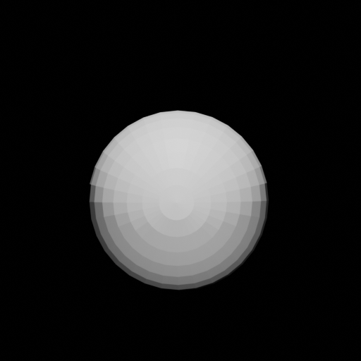 | 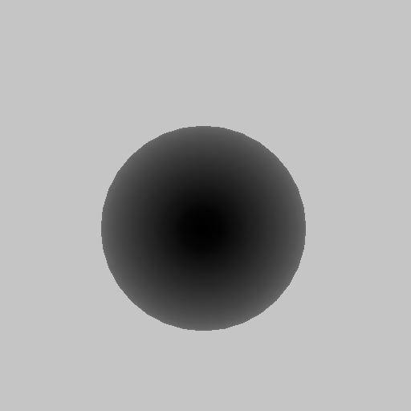 | 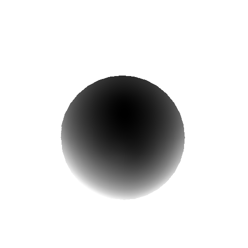 | 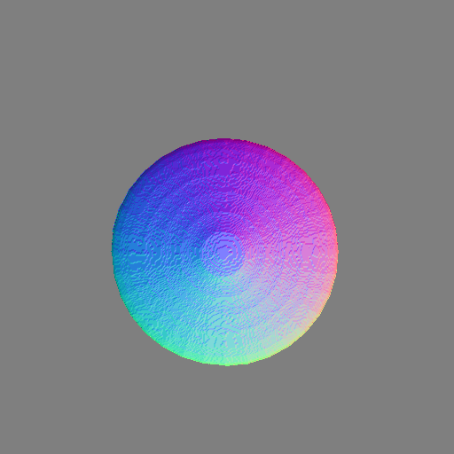 | 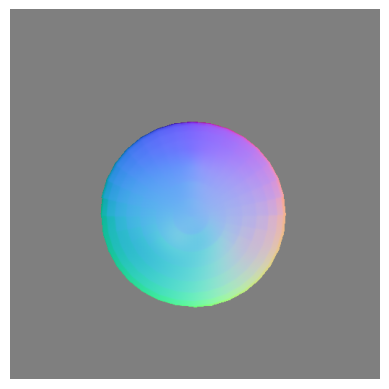 |
| 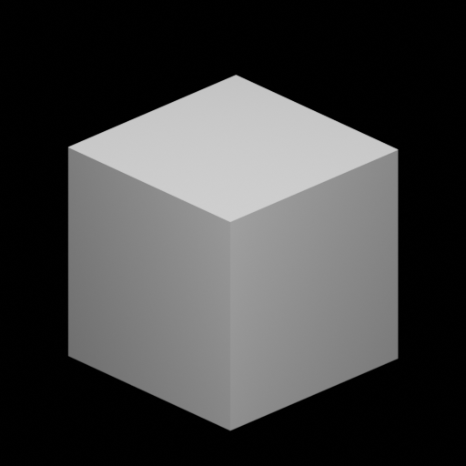 | 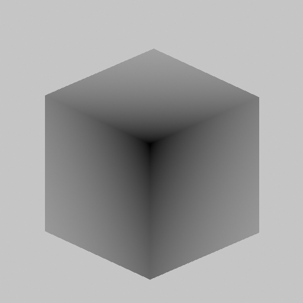 | 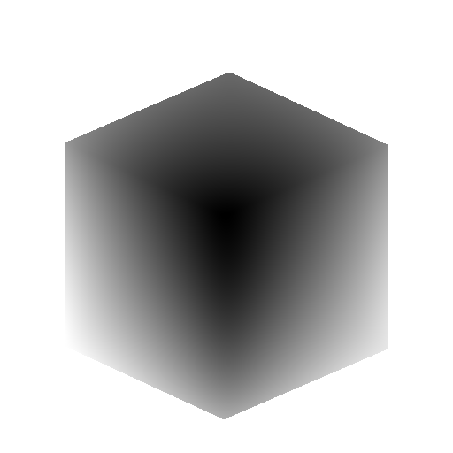 | 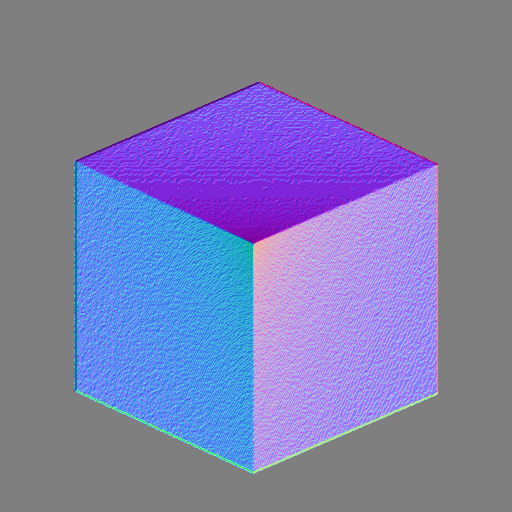 | 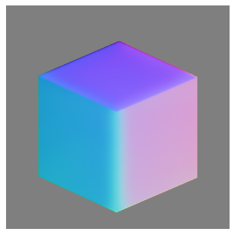 |
| 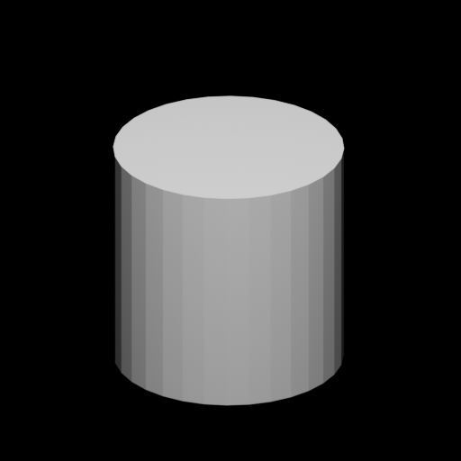 | 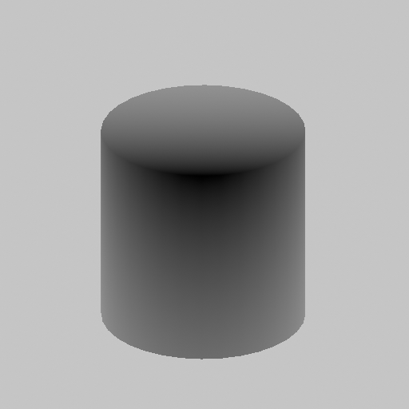 | 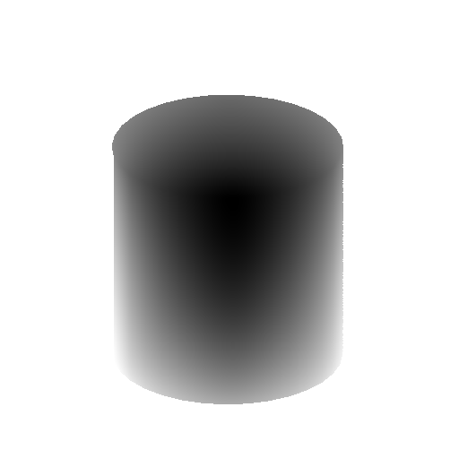 | 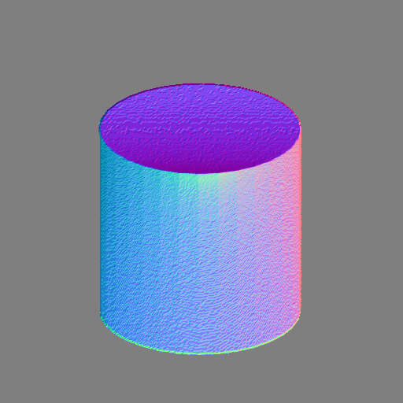 | 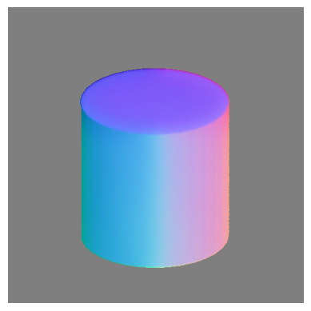 |
| 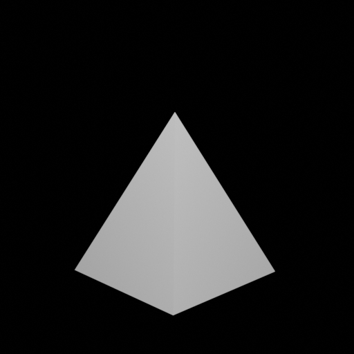 | 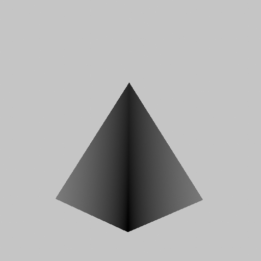 | 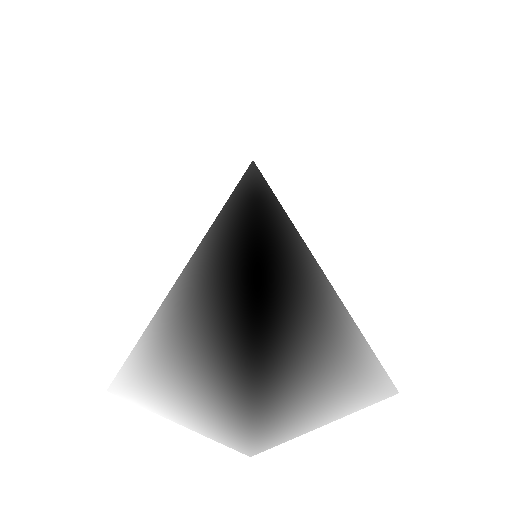 | 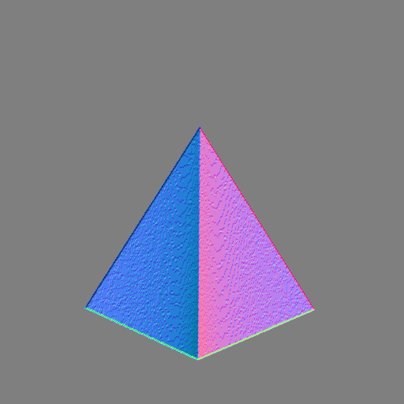 | 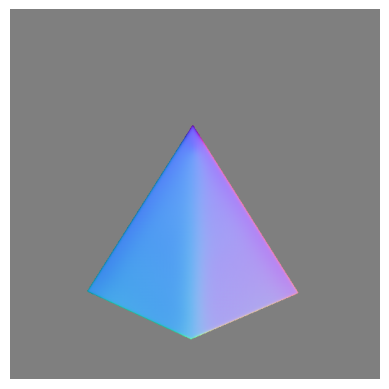 |
| 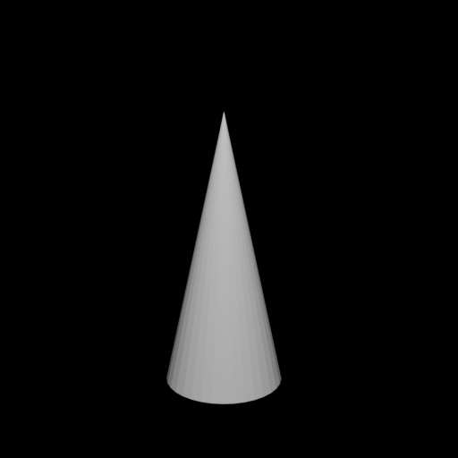 | 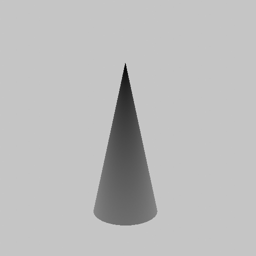 | 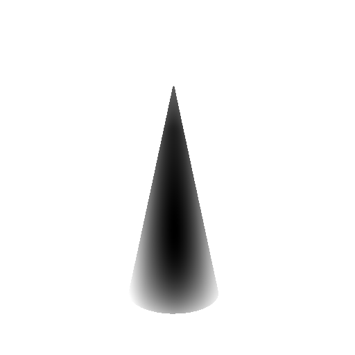 | 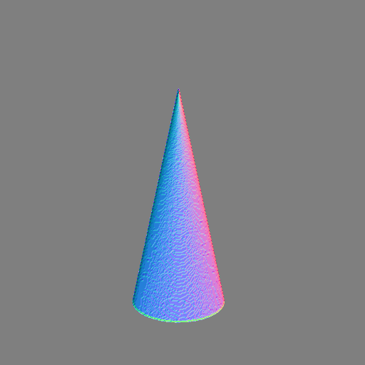 | 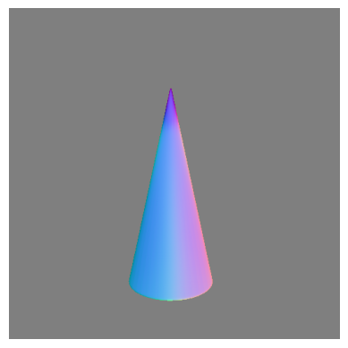 |
